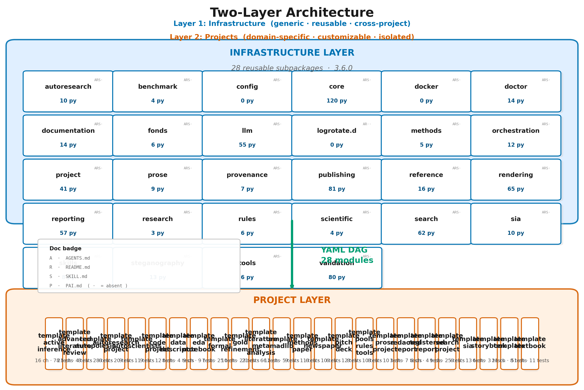

# Template: Meta-Research Project

A self-referential research study that programmatically analyzes and documents the Docxology Template repository's own architecture, pipeline, and security layer.

**Location:** git-tracked public exemplar at `projects/templates/template_template/` in the public template checkout.

## When to use this template

Use this template when your research subject is **the repository itself** —
programmatic introspection of architecture, pipeline DAGs, module inventories,
and security layers, rendered as a manuscript whose every metric is computed
live (autopoietic: the paper regenerates itself from the code it describes).
It is the reference for binding `${var}` metric tokens to introspection code.

If you are studying an external subject rather than the repo, start from
[`template_code_project`](https://github.com/docxology/template_code_project) (computational research)
or [`template_prose_project`](https://github.com/docxology/template_prose_project) (editorial
pipeline). Full roster:
[`projects/AGENTS.md`](https://github.com/docxology/template/blob/main/projects/AGENTS.md#permanent-canonical-exemplars).

## Publication and rendering

The publishing metadata and per-platform status below are **compiled from
`docs/manuscript/config.yaml`** by `infrastructure.publishing.status_report` — do not
hand-edit between the markers; update the config and regenerate (see the legend).

<!-- PUBLISHING-STATUS:START (generated by infrastructure.publishing.status_report) -->
**A template/ approach to Reproducible Generative Research** · intended v2.0.0 (unreleased) · Apache-2.0 · Daniel Ari Friedman

Intended release: v2.0.0 — unreleased.
Last published release: v1.0.9. Recorded publication links refer to that release.

Concept DOI: [10.5281/zenodo.20419007](https://doi.org/10.5281/zenodo.20419007) | Last published version DOI: [10.5281/zenodo.20976048](https://zenodo.org/records/20976048) | Repository: [docxology/template_template](https://github.com/docxology/template_template)

Publishing surface — 20 platforms, 0 published for the intended release:

| Platform | Tier | Status | Reference | Credentials |
| --- | --- | --- | --- | --- |
| zenodo | first-class | 📚 historical reference | [10.5281/zenodo.20419007](https://doi.org/10.5281/zenodo.20419007) | `ZENODO_API_TOKEN` |
| github | first-class | 📚 historical reference | [docxology/template_template](https://github.com/docxology/template_template) | `GITHUB_TOKEN` |
| arxiv | first-class | ⚪ available | — | — |
| pypi | first-class | 📚 historical reference | [https://test.pypi.org/project/template-template-meta-project/1.0.9/](https://test.pypi.org/project/template-template-meta-project/1.0.9/) | `PYPI_TOKEN`, `TESTPYPI_TOKEN` |
| ipfs_pinata | first-class | 📚 historical reference | [https://gateway.pinata.cloud/ipfs/QmVr4UREM1NeaSfY1pNJdjFjrRrGMZLvnNqCY2cRaGadry](https://gateway.pinata.cloud/ipfs/QmVr4UREM1NeaSfY1pNJdjFjrRrGMZLvnNqCY2cRaGadry) | `PINATA_JWT` |
| ipfs_web3storage | first-class | ⚪ available | — | `WEB3_STORAGE_TOKEN` |
| software_heritage | first-class | 📚 historical reference | [https://archive.softwareheritage.org/browse/origin/?origin_url=https://github.com/docxology/template_template](https://archive.softwareheritage.org/browse/origin/?origin_url=https://github.com/docxology/template_template) | — |
| github_pages | first-class | 📚 historical reference | [https://docxology.github.io/template_template/](https://docxology.github.io/template_template/) | `GITHUB_TOKEN` |
| cloudflare_pages | first-class | ⚪ available | — | `CLOUDFLARE_API_TOKEN` |
| netlify | first-class | 📚 historical reference | [https://6a44431e738f1faeef68e5f6--tranquil-kleicha-0c9203.netlify.app](https://6a44431e738f1faeef68e5f6--tranquil-kleicha-0c9203.netlify.app) | `NETLIFY_AUTH_TOKEN` |
| huggingface_hub | first-class | 📚 historical reference | [https://huggingface.co/datasets/ActiveInference/template_template](https://huggingface.co/datasets/ActiveInference/template_template) | `HUGGINGFACE_TOKEN`, `HF_TOKEN` |
| osf | first-class | 📚 historical reference | [https://osf.io/byf23/](https://osf.io/byf23/) | `OSF_TOKEN` |
| amazon_kdp | documented | 🟡 planned | — | `AMAZON_KDP_EMAIL`, `AMAZON_KDP_PASSWORD` |
| google_play_books | documented | 🟡 planned | — | `GOOGLE_PLAY_BOOKS_SERVICE_ACCOUNT_JSON` |
| gumroad | documented | 🟡 planned | — | `GUMROAD_ACCESS_TOKEN` |
| leanpub | documented | 🟡 planned | — | `LEANPUB_API_KEY` |
| lulu | documented | 🟡 planned | — | `LULU_CLIENT_KEY`, `LULU_CLIENT_SECRET` |
| draft2digital | documented | 🟡 planned | — | `DRAFT2DIGITAL_API_TOKEN` |
| stripe | documented | 🟡 planned | — | `STRIPE_SECRET_KEY`, `STRIPE_PUBLISHABLE_KEY` |
| ingramspark | documented | 🟡 planned | — | `INGRAMSPARK_CLIENT_ID`, `INGRAMSPARK_CLIENT_SECRET` |

_Keywords: reproducible research, infrastructure-as-code, steganography, cryptographic provenance, LaTeX rendering, modular infrastructure, publication integrity, zero-mock testing, thin orchestrator, two-layer architecture, FAIR4RS, research software engineering._

_Status legend: ✅ published (durable identifier recorded in `config.yaml`) · 🔵 reserved (identifier reserved but not yet registered by final publication) · 📚 historical reference (last published release; not intended-version publication evidence) · ⚪ available (adapter implemented and locally verifiable) · 🟡 planned. This block is generated — edit `docs/manuscript/config.yaml`, then regenerate with `uv run python -m infrastructure.publishing.status_report --project <path> --write`._
<!-- PUBLISHING-STATUS:END -->

The GitHub release is labeled `v1.0.9`. Its tagged source declares `1.0.8` as
the package and manuscript version. [GitHub release](https://github.com/docxology/template_template/releases/tag/v1.0.9) ·
[Tagged package metadata](https://github.com/docxology/template_template/blob/c83c17d594cf211e80db8fe9967ed9edd3f767f0/pyproject.toml#L3) ·
[Tagged manuscript configuration](https://github.com/docxology/template_template/blob/c83c17d594cf211e80db8fe9967ed9edd3f767f0/manuscript/config.yaml#L6)

The 3 platforms still shown ⚪ available are not automatable to "published" with
current tooling/credentials, not an oversight: **arXiv** has no submission API
in this codebase (`infrastructure.publishing.arxiv` only prepares a local
tarball — a human must upload it via arxiv.org and the resulting `arxiv` URL
would then be added to `publication.published_artifacts`); **Cloudflare
Pages** needs a `CLOUDFLARE_ACCOUNT_ID` the configured API token cannot
auto-discover; **IPFS (Web3.Storage)** has no `WEB3_STORAGE_TOKEN` configured.

See the [documentation index](docs/README.md), [verification guide](docs/VERIFICATION.md),
and [rendering pipeline](docs/rendering_pipeline.md) for the standalone workflow.

## Overview

- **Repository introspection:** `src/template_template/core/introspection.py` loads the YAML pipeline DAG, discovers modules/projects, and aggregates file counts.
- **Metrics injection:** `src/template_template/metrics/metrics.py` computes manuscript variables; `inject_metrics.py` renders `${var}` tokens into `output/manuscript/`.
- **Figures:** `scripts/generate_architecture_viz.py` produces four PNGs from live introspection data.

## Directory Structure

| Folder | Contents |
|--------|----------|
| [`docs/manuscript/`](docs/manuscript/) | Numbered Markdown chapters + `config.yaml` (+ `config.yaml.example` copy-and-customize starting point) + `references.bib` |
| `scripts/` | Two thin orchestrators (figures, metrics) |
| `src/template_template/` | Introspection, metrics, injection, visualization |
| `tests/` | Full suite with the coverage floor declared in `pyproject.toml` |
| `output/` | PDF, figures, metrics JSON, rendered manuscript |

## Pipeline Outputs

| Artifact | Path |
|----------|------|
| Rendered PDF | `output/pdf/template_template_combined.pdf` |
| Metrics JSON | `output/data/metrics.json` |
| Rendered chapters | `output/manuscript/*.md` |
| Figures | `output/figures/*.png` |

See [`docs/VERIFICATION.md`](docs/VERIFICATION.md) for the full gate checklist.

The metrics payload carries a schema-versioned receipt, and the comparative
matrix is checked in lockstep against the manuscript capability rows. The
steganography defaults receipt records that executable configuration is
disabled unless explicitly requested; missing optional tooling is reported as
unavailable rather than silently promoted to a successful publication claim.

## Template integrity

- [Maintenance backlog](docs/backlog.md)
- [Example configuration](docs/manuscript/config.yaml.example)
- [Standalone test and evidence contract](docs/VERIFICATION.md)
